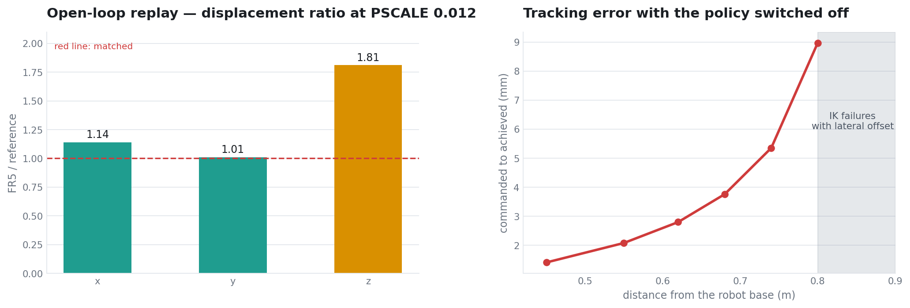
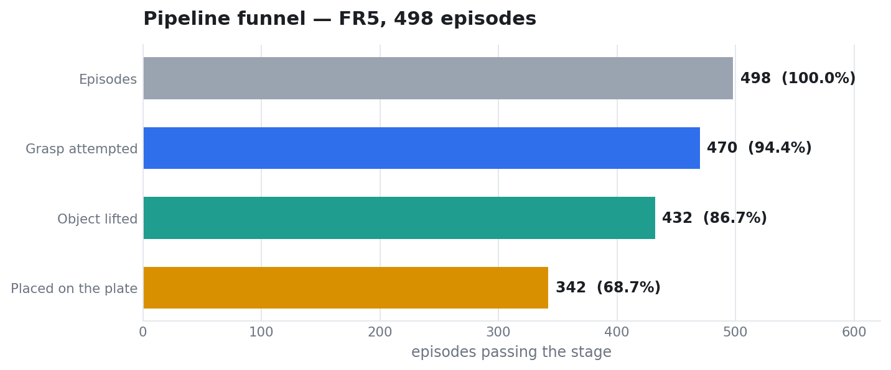
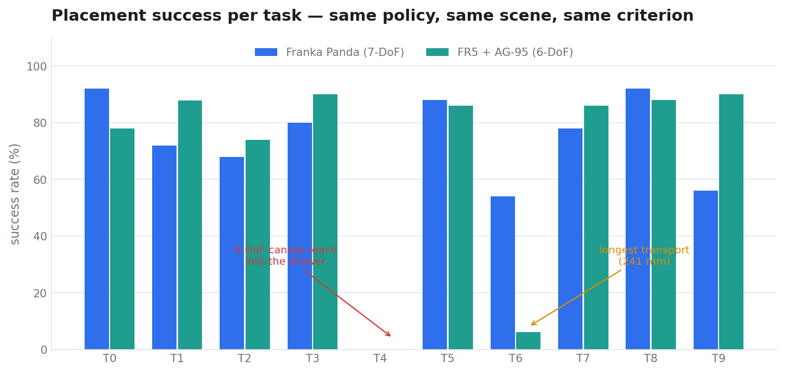

# GR00T N1.7 × Isaac Sim — Franka 로 학습된 VLA 를 6축 FR5 로 옮기기(그리퍼를 수정할 예정입니다.)

MuJoCo/robosuite 의 Franka Emika Panda 로 학습된 GR00T N1.7 을 Isaac Sim 6.0.1 의
**FAIRINO FR5 (6축) + DH AG-95** 로 옮겨 LIBERO-Spatial 10개 태스크를 실행했다.
**GR00T 의 가중치는 학습시키지 않았다(제로샷).** 어댑터 계층만 조정했고, 참조 궤적
재생이나 태스크별 오프셋은 쓰지 않았다.

| | 측정 결과 |
|---|---|
| **로봇을 바꿔도 이식 성능이 유지된다** | Franka 340/500 (68.0%) 대 FR5 342/498 (68.7%). 차이 +0.7 %p, 95 % CI [−5.1, +6.4], Fisher p = 0.84 |
| **어댑터 값은 개루프 재생과 정책 프로브로 유도한다** | 폐루프 성능으로 스케일을 쓸면 태스크 0 에서만 맞는 값이 나온다. `PYSC=3.0` 이 그 예로, 태스크 1 에서 y 를 360 mm 과주행했다 |
| **6축의 한계는 작업공간에서 드러난다** | 서랍 안 태스크에서 IK 가 2,800행 중 2,638~2,749 실패. 파지 시도 22/50, 배치 0/50 |
| **관절 점프 제한으로 물리 발산이 사라진다** | 손목 관절이 −299° 도는 IK 해가 articulation 발산을 부른다. 제한 전 48판 중 5건(10.4 %), 후 498판 중 0건 (Fisher p = 4.3 × 10⁻⁶) |
| **그리퍼가 다르면 판정 코드의 부등호가 뒤집힌다** | Franka 는 손가락 폭(클수록 열림), AG-95 는 관절각(클수록 닫힘). 그대로 쓰면 해제 검사가 항상 통과한다 |

첫 번째가 이 저장소의 주된 결과다.

[어댑터 정합](docs/adapter.md) ·
[6축 고유 문제](docs/six-dof.md) ·
[성공 판정](docs/criteria.md) ·
[기각된 대책](docs/rejected.md)

---

## 정확히 하기 위해 밝혀두는 것

- **task 4 만 다른 조건으로 측정했다.** 나머지 9개는 `PHYSFIX=1`, task 4 는 `PHYSFIX=0` 이다.
  이유와 근거는 아래 5절에 있다. 조건 통일을 위한 전체 재측정이 필요하다.
- **판정에서 S10(해제 후 2초 물리 유지)을 제외했다.** LIBERO 시연은 물체를 접시에
  놓는 프레임에서 끝나고 놓은 뒤 구간이 학습 데이터에 없다. Franka 쪽 68.0 % 도
  같은 기준으로 재집계한 값이며, 원래 보고값 67.6 % 는 S10 을 포함한다.
- **방해 물체가 양쪽 모두 테이블 밖에 있다** (설정의 `[0.34, -0.4]`).
  목표 선택 난이도가 낮은 조건이다.
- **task 4·6 을 제외하면 FR5 85.0 % 대 Franka 78.2 % (p = 0.017) 이나, 사후 선택이다.**
  전체 10태스크 비교가 사전에 정한 지표다.
- **회전 스케일(`RSCALE`·`RMAX`·`RBASE`)은 미검증이다.** 축각 표현이 roll ≈ π 에서
  퇴화해 이동비를 측정하지 못했고 Franka 쪽 값을 승계했다.
- **정책 출력이 FR5 화면에서 더 흩어진다.** 같은 이미지를 8회 질의했을 때 자체 산포가
  0.068~0.085 로 참조 이미지(0.021)의 3~4배다. FR5 팔이 3인칭 화면에 찍히는 것이
  학습 분포 밖이기 때문으로 보이며, 어댑터로는 고칠 수 없다.

---

## 1. 무엇이 바뀌는가

| 항목 | 학습 도메인 | 이식 대상 | 처리 |
|---|---|---|---|
| 정책 가중치 | GR00T N1.7 | 동일 | 변경 없음 |
| 지시문 | LIBERO 원문 | 동일 | 변경 없음 |
| **로봇** | **Franka Panda (7축)** | **FAIRINO FR5 (6축)** | **어댑터** |
| **그리퍼** | **Panda hand (폭 0~80 mm)** | **DH AG-95 (관절 0~0.93 rad)** | **환산** |
| 시뮬레이터 | MuJoCo | Isaac Sim / PhysX | 이식 |
| 제어기 | OSC_POSE | 관절 위치 PD | 어댑터 |
| 역기구학 | robosuite 내장 | Lula | 어댑터 |
| 성공 판정 | BDDL 술어 | 없음 | 재구성 |

씬, 물체 배치, 카메라 설정, 체크포인트는 Franka 실험과 같은 파일을 쓴다.
**달라지는 것은 로봇과 그리퍼뿐이다.**

---

## 2. 어댑터를 어떻게 맞췄나

### 2-1. 스케일 — 개루프 재생

정책 호출 없이 참조 액션을 어댑터에 투입하고 첫 질의(q0→q1)의 EE 변위를 대조한다.
정책과 관측이 배제되므로 남는 변수는 어댑터 변환뿐이고 결과가 결정론적이다.



```
PSCALE     dx      dy      dz     참조 대비
0.008    +17.4   +17.4    +9.2
0.012    +26.4   +26.0   +14.3    x 1.14   y 1.01   z 1.81
0.016    +35.4   +34.5   +19.4
0.020    +44.4   +43.1   +24.6

참조 (MuJoCo, 4 에피소드 평균)   dx +23.2   dy +25.8   dz +7.9 mm
```

변위가 `PSCALE` 에 정확히 비례한다(비 2155~2220 으로 일정). Franka 에서 겪은
도달률 자기참조가 FR5 에서는 나타나지 않는다 — 6축이라 자세가 단순해서로 보인다.

축별 비가 1.00 이 되는 값이 `PSCALE=0.0105  PXSC=1.00  PYSC=1.13` 이다.

**z 는 보정하지 않았다.** 참조의 dz 변동계수가 0.34 로 가장 크고(4.9~11.0 mm),
실제로 `PZSC` 를 0.63·0.75 로 낮추자 task 8 의 `tip-rim` 이 −0.010 에서 −0.045 로
악화됐다. 폐루프에서는 스케일을 줄이면 정책이 목표에 못 닿아 오차가 남는다.

### 2-2. 관측 — 정책 프로브

정책 서버에 동일 상태·동일 지시문으로 질의하고 이미지만 바꿔 참조 액션과의 거리를
잰다. 로봇을 움직이지 않으므로 에피소드를 쓰지 않는다.

```
조건                      참조거리   자체산포   (8회 반복)
참조 이미지 (기준선)        0.070     0.021
FR5 그대로                0.130     0.084
FR5 3인칭만 미러           0.105     0.085
FR5 손목만 미러            0.288     0.068
FR5 둘 다 미러             0.289     0.073
```

손목을 한 번 더 뒤집으면 0.288 로 망가진다. 손목 미러가 필요하다는 뜻이다.

설정을 보면 확정된다. 씬이 `flip_horizontal: true` 로 3인칭을 한 번 뒤집는데,
러너의 `FLIP` 기본값이 `h` 라 한 번 더 뒤집힌다. `WFLIP` 기본값은 빈 문자열이라
손목은 아예 안 뒤집힌다. **`FLIP=n  WFLIP=h` 가 맞다.**

폐루프에서 파지 오차가 y −140 mm 에서 −56 mm 로 줄었다.

### 2-3. 상태 z

`ZOFF` 는 `grasp_link` 와 손가락 패드의 z 차이를 보정하는 값인데, 정책에 보내는
상태에도 적용된다.

```
참조 초기 상태   z 1.17328
ZOFF=0.031       z 1.2034   30 mm 높음.  파지 시 tip-rim −0.043
ZOFF=0           z 1.1724   참조와 0.9 mm.  tip-rim −0.006
```

정책이 자기 높이를 30 mm 높게 알면 하강 명령이 달라지고 접근 궤적 전체가 틀어진다.

---

## 3. FR5 고유 문제 세 가지

### 3-1. 손목 관절 뒤집힘 → PhysX 발산

6축은 여유자유도가 0 이라 같은 EE 자세에 대한 해가 이산적이다. 해가 분기하면
손목이 크게 돈다.

```
[JD] s006  max 5.224   5번 관절(wrist2) 이 −299°
     s007  8.090 → 57.9 → 574 → 13,924 → 254,266 → 3,151,244
```

관절각이 300만 rad 까지 가며 articulation 이 터지고, 주변 물체가 수 m~수 km 날아간다.
`ikfail > 0` 인 판에서 발산이 38 %, `ikfail = 0` 에서 5 % 였다 (Fisher p = 0.027).

한 스텝 관절 변화가 0.5 rad 을 넘는 IK 해를 폐기하면(`MAXJ=0.5`) 사라진다.

```
MAXJ 미적용   관절 점프 로그 19줄,  발산 48판 중 5건 (10.4%)
MAXJ=0.5      관절 점프 로그  0줄,  발산 498판 중 0건
```

### 3-2. 파지 게이트가 고정 높이 기준

어댑터에는 "그리퍼가 일정 높이보다 위에 있으면 정책의 폐쇄 명령을 무시한다"는
게이트가 있다. 기본 문턱 0.945 는 테이블 위 물체 기준이다.

물체가 라메킨 위(z 0.939)에 있는 태스크에서는 닫아야 할 높이가 0.99 인데,
게이트가 0.945 까지 내려가야만 닫게 한다. 그릇 테두리를 지나 몸통 중간에서 닫히고,
물체를 밀어내 라메킨에서 떨어뜨린 뒤 바닥에서 다시 잡는다.

```
GZFRAC=0     개방 강제 126~206회,  tip-rim −0.034,  들기 0/3
GZFRAC=0.8   개방 강제      0회,  tip-rim −0.016,  들기 3/3
[GATE] obj z 0.9390 + 80% x 0.05265 -> GZMIN 0.9811
```

`GZFRAC` 는 물체의 실제 높이에서 문턱을 계산한다. 10태스크 중 5개가 높은 물체다.

### 3-3. 그리퍼 단위가 뒤집혀 판정이 무력화

```python
_rop = joint_positions[-2] > REFOPEN    # Franka: 손가락 폭, 클수록 열림
```

FR5 는 관절각이라 **클수록 닫힘**이다. 부등호의 의미가 반대다. 단위가 안 맞아
`REFOPEN=-1` 로 꺼두면 모든 값이 −1 보다 커서 **항상 "열림"으로 통과**한다.
물체를 쥔 채 접시 위에 있어도 해제로 판정된다.

관절각 문턱으로 바꿔야 한다. 손가락 8 mm 는 관절 0.744 rad 이다.

---

## 4. 결과





| task | 목표 위치 | n | 파지 시도 | 들기 | 배치 | Franka 배치 |
|---|---|---|---|---|---|---|
| T0 | 접시와 라메킨 사이 | 50 | 50 (100%) | 43 (86%) | **39 (78%)** | 46/50 (92%) |
| T1 | 라메킨 옆 | 49 | 49 (100%) | 49 (100%) | **43 (88%)** | 36/50 (72%) |
| T2 | 테이블 중앙 | 50 | 50 (100%) | 50 (100%) | **37 (74%)** | 34/50 (68%) |
| T3 | 쿠키 상자 위 | 50 | 50 (100%) | 45 (90%) | **45 (90%)** | 40/50 (80%) |
| T4 | 서랍 안 | 50 | 22 (44%) | 9 (18%) | **0 (0%)** | 0/50 (0%) |
| T5 | 라메킨 위 | 50 | 50 (100%) | 47 (94%) | **43 (86%)** | 44/50 (88%) |
| T6 | 쿠키 상자 옆 | 49 | 49 (100%) | 47 (96%) | **3 (6%)** | 27/50 (54%) |
| T7 | 스토브 위 | 50 | 50 (100%) | 47 (94%) | **43 (86%)** | 39/50 (78%) |
| T8 | 접시 옆 | 50 | 50 (100%) | 45 (90%) | **44 (88%)** | 46/50 (92%) |
| T9 | 캐비닛 위 | 50 | 50 (100%) | 50 (100%) | **45 (90%)** | 28/50 (56%) |

```
FR5     n=498   파지 시도 470 (94.4%)   들기 432 (86.7%)   배치 342 (68.7%)
Franka  n=500                                             배치 340 (68.0%)

차이 +0.7%p   95% CI [−5.1, +6.4]   Fisher p = 0.84
물리 발산 0/498
```

T1 과 T9 는 각각 49판이다. RTX GPU 크래시로 한 판씩 유실됐다.

### 낮은 두 태스크

**T4 — 6축 작업공간 한계.** IK 가 2,800행 중 2,638~2,749 실패한다(94~98 %).
작업공간 클램프는 `0/0/0/0` 이므로 **명령 위치는 범위 안인데 해를 못 찾는다.**
서랍 안쪽이 깊고 좁아 여유자유도 0 으로는 그 자세에 도달할 수 없다.
Franka(7축)도 이 태스크는 0/50 이나, 그쪽은 서랍에서 꺼낸 뒤 이송에 실패한다.

**T6 — 이송 거리 최장.** 물체에서 접시까지 241 mm 로 T5(143 mm)의 1.7배다.
들기는 47/49 인데 파지 후 미끄러짐이 0.12~0.45 로 다른 태스크(0.10 근처)보다 크고,
들고 가다 놓친다. `GKP` 상향은 역효과였다(30000 에서 미끄러짐 0.15 → 0.34,
100000 에서 PhysX 발산).

---

## 5. task 4 의 조건이 다른 이유

`physfix` 는 조작 대상 물체에 속도 제한과 솔버 반복을 적용하는 모듈이며,
적용 과정에서 `scene.world.reset()` 을 호출한다.

**이 reset 이 빌드 시점에 열어둔 서랍을 닫힌 위치로 되돌린다.** 목표 물체는
서랍 바닥 없이 스폰 높이에서 테이블로 떨어진다.

```
PHYSFIX=1   정착 후 물체 = [0.0975, -0.1373, 0.8980]   테이블
PHYSFIX=0   정착 후 물체 = [0.0960, -0.1416, 1.0626]   서랍 안 (Franka 와 동일)
```

두 조건의 스폰 좌표는 `[0.096038, -0.141643, 1.063004]` 로 완전히 같다.
60스텝 정착 중에만 갈린다.

`PHYSFIX=0` 에서 발산이 늘지 않음을 T5·T8 각 5판으로 확인했다.

```
PHYSFIX=1   T5 3/5   T8 5/5   발산 0
PHYSFIX=0   T5 2/5   T8 4/5   발산 0
```

관절 점프 제한(`MAXJ=0.5`)이 이미 발산을 막고 있어 `physfix` 의 역할이 남아 있지 않다.
**다음 측정에서는 전체를 `PHYSFIX=0` 으로 통일해야 한다.**

---

## 6. 성공 판정

LIBERO 시연은 물체를 접시에 놓는 프레임에서 끝난다. 참조 에피소드 884 스텝 중
성공 판정이 참인 스텝은 10개(에피소드당 1개)이고, **놓은 뒤 구간이 한 프레임도 없다.**

정책에는 보상도 종료 신호도 성공 여부도 들어가지 않는다. 놓은 뒤의 상태는 학습 분포
밖이고 실제로 재파지 시도가 나온다. 그 행동은 성능 지표가 아니므로 판정에서 뺀다.

```
d  < 0.050              물체 중심이 접시 중심에서 50 mm 이내
|b_z − seat| < 0.006    안착 높이.  seat = 접시 원점 + 13.0 mm
```

두 조건이 동시에 성립하는 순간이 성공이다.

문턱은 결과에 맞춰 고르지 않고 이식 씬의 물리 측정에서 유도했다.

| 지표 | 출처 | 값 |
|---|---|---|
| 안착 높이 | 낙하 정착 실측, 4개 태스크 동일 | +13.0 mm |
| 배치 반경 | 낙하 오프셋 실측. 50 mm 까지 기울기 0.4°, 60 mm 에서 흔들림 | 50 mm |

기하 계산(접시 반경 68.8 − 물체 반경 55.9 = 12.9 mm)은 "밑면 전체가 접시 안"이라는
더 엄격한 기준이며 참조 실측과 일치한다. 50 mm 는 그보다 느슨하되 물리적으로
유지되는 한계다.

**집계는 판정 성립 로그로 한다.** 내부 플래그는 이후 재파지가 일어나면 리셋되므로
그것으로 세면 32 % 라는 잘못된 값이 나온다.

---

## 7. 재현

| 항목 | 값 |
|---|---|
| 시뮬레이터 | NVIDIA Isaac Sim 6.0.1, PhysX 60 Hz |
| 로봇 | FAIRINO FR5 (6축) + DH AG-95, 관절 위치 PD |
| 역기구학 | Lula, `grasp_link` 프레임, 4단계 폴백 |
| 정책 | GR00T N1.7, `libero_spatial` 체크포인트, embodiment `libero_sim` |
| 관측 | 3인칭 256×256 fovy 45°, 손목 256×256 fov 75° |
| 참조 | MuJoCo / robosuite + Franka Panda, OSC_POSE, `n_action_steps = 8` |

```
PSCALE=0.0105  PXSC=1.00  PYSC=1.13  PZSC=1.00
ROTOFF=1  GSIGN=1  QROT=ym90  PACC=1
SUBSTEP=3  NSUB=8  KSAMP=1
GCLOSE=0  GCHUNK=1  NOREOPEN=0  GINIT=0.0208  GZFRAC=0.8  GKP=10000
MAXJ=0.5  FLOORZ=0.905  ZOFF=0  SETTLEQ=60
FLIP=n  WFLIP=h  WRIST=real  HANDLINK=grasp_link  WAXES=world
WX=-0.10  WY=0  WZ=0.05  WRX=0  WRY=0  WRZ=0  WFOV=75
TERMREF=1  TERMHOLD=1  HOLDQ=0  RETWAIT=10
REFR=0.050  PSEAT=0.0130  REFZTOL=0.006
REFSTILL=1  REFSTOL=999  REFOPENJ=0
OKLIFT=0.03  OKSTILL=3  OKZ=0.004
MAXPMOVE=0.005  MAXDIST=0.005  MAXBPEN=0.003  MAXBIMP=12
NEEDGRASP=1  NEEDRET=0

MAXSTEPS: T0,1,2,3,5,8=150 / T6,9=250 / T4,7=350
```

```bash
python3 scripts/plot.py     # assets/ 그림 3종
python3 scripts/stats.py    # README 의 모든 검정값
```

**표본 크기 주의.** 조건당 3~5판으로는 판정이 흔들린다. 파라미터 비교는 최소 10판,
최종 측정은 태스크당 50판을 썼다.

### 참조 NPZ 는 Franka 것을 쓴다

참조 롤아웃 파일에는 액션(무차원 7차원)과 그때의 EE world 좌표만 들어 있다.
관절각도 링크 길이도 로봇 이름도 없다.

**FR5 전용 참조는 만들 수 없다.** FR5 로 다시 뽑으면 자기 자신과 비교하게 되어
스케일 비가 항상 1.0 이 된다. 기준은 "정책이 학습된 환경이 낸 정답"이어야 한다.

---

## 8. 다음 측정

- [ ] 전체 10태스크를 `PHYSFIX=0` 으로 재측정해 조건 통일
- [ ] T6 의 파지 유지 실패 — AG-95 접촉 모델과 mimic 구조
- [ ] T4 를 7축 로봇과 비교해 6축 한계를 정량화
- [ ] 회전 스케일을 쿼터니언 각도로 재측정
- [ ] 방해 물체를 참조 위치로 복원한 조건
- [ ] 3인칭 화면의 로봇 외형이 정책 출력 산포에 주는 영향

---

## 저장소 구성

```
README.md                  본 문서
docs/
  adapter.md               어댑터 정합 절차와 측정 원본
  six-dof.md               6축 고유 문제 세 가지
  criteria.md              성공 판정과 문턱의 근거
  rejected.md              기각한 대책 13건
data/
  task_summary.csv         태스크별 집계
scripts/
  plot.py                  그림 생성
  stats.py                 통계 검정
assets/                    그림 3종
```

### 통계 처리

두 비율의 비교는 Fisher 정확검정, 차이의 95 % 신뢰구간은 Newcombe 방법을 썼다.
계산은 `scripts/stats.py` 에 있고, README 의 모든 검정값이 그 출력이다.
